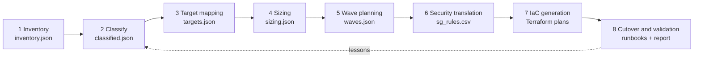

# VMware Exit Playbook

**Stay, move or leave VMware: a schema-driven reference pipeline for planning and executing the decision.**

Broadcom's VMware licensing changes have pushed many organizations to re-examine their virtualization strategy. This repository treats that as an architecture decision, not an anti-VMware statement. It provides a pipeline that takes an inventory of a VMware estate and produces a recommendation, a sizing, a wave plan, translated security rules, infrastructure as code and cutover runbooks.

| Path | What it means | Typical targets |
| --- | --- | --- |
| **Stay** | Keep VMware, change where it runs | Amazon EVS, VMware Cloud on AWS |
| **Move** | Rehost or replatform onto native cloud | Amazon EC2, Microsoft Azure |
| **Leave** | Move onto an open-source hypervisor | KVM, Apache CloudStack, OpenStack |

An exit is not always the right answer. The pipeline explains every recommendation, including when staying is the better choice.

## Pipeline



Every stage reads a versioned schema and writes one. Any dataset that matches the input schema runs end to end, so the pipeline does not depend on any one organization's data. See [docs/architecture.md](docs/architecture.md) for the stage contracts.

## Quick start

Requires Python 3.10 or newer.

```bash
python3 -m venv .venv
source .venv/bin/activate
pip install -e ".[dev]"

# Stage 1: turn an RVTools export into inventory.json
exitplaybook-inventory --input samples/rvtools_vinfo_sample.csv --output runs/inventory.json

# Run the tests
pytest
```

Stage details: [01 Inventory](docs/stages/01-inventory.md).

## Design principles

- **Schema contracts between stages.** Each handoff is validated; bad input fails early with a clear error.
- **Configuration over code.** Decision weights, column mappings and thresholds live in `config/`.
- **Explainable output.** Every recommendation carries the criteria that drove it.
- **Synthetic data only.** Sample datasets are invented; no real customer data is included.
- **Build vs buy is explicit.** Each stage documents which commercial or open-source tools already cover it. See [docs/build-vs-buy.md](docs/build-vs-buy.md).

## Repository layout

```text
docs/        architecture, decision framework, stage guides, ADRs, runbooks, traps
schemas/     JSON Schema for every stage handoff
src/         one package per pipeline stage
config/      weights, mappings and thresholds
samples/     synthetic datasets
tests/       unit, schema and end-to-end tests
terraform/   landing zone and per-wave modules
```

## Roadmap

| Release | Scope | Status |
| --- | --- | --- |
| v0.1 | Inventory and classify, schemas, synthetic data, CI | In progress |
| v0.2 | Decision scoring and sizing | Planned |
| v0.3 | Wave planning and security translation | Planned |
| v0.4 | Terraform rendering and cutover runbooks | Planned |
| v1.0 | Full end-to-end run and documentation pack | Planned |

## Background

The design generalizes lessons from a multi-year enterprise program that moved 1,500+ VMs from on-premises VMware to VMware Cloud on AWS and then to native AWS, using VMware HCX, AWS Direct Connect and AWS Application Migration Service. Those lessons are captured as rules in [docs/traps.md](docs/traps.md).

## Disclaimer

This is an independent reference design. It is not vendor guidance and contains no employer or client material. Validate every decision against your own environment, licensing terms and vendor documentation.

## License

[MIT](LICENSE)
