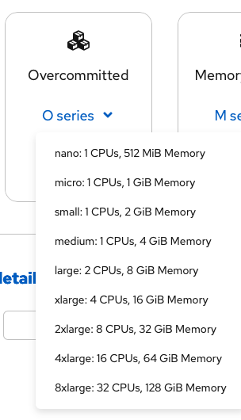
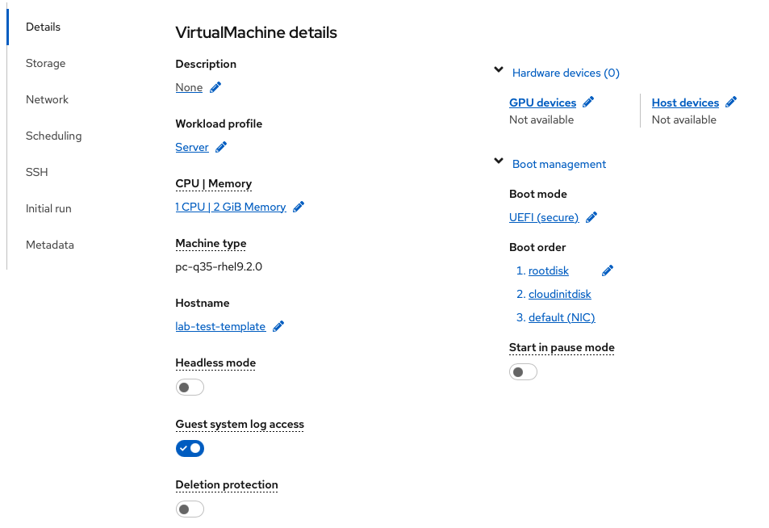
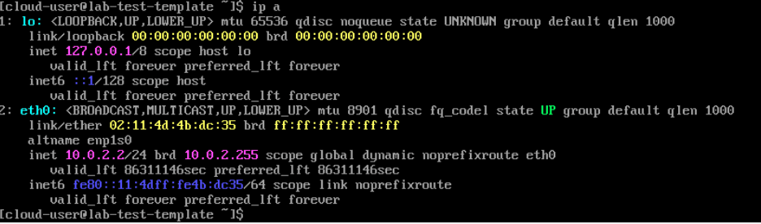
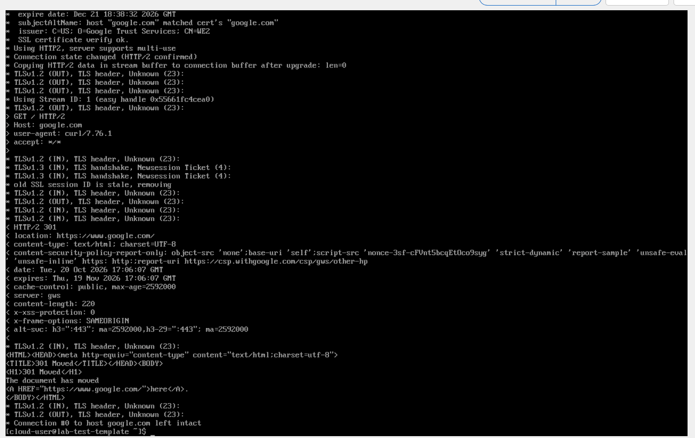

# OpenShift Virtualization

> **Status: Partly tested.** Built from hands-on lab sessions, not a production migration.
> Lab sessions so far: 1 (Red Hat Developer Sandbox). Lab cost so far: $0.

## Why I'm looking at it

Not every organization leaving VMware wants the public cloud. Many just want to keep their own data center, on a platform whose licensing they can live with. OpenShift Virtualization is one of the most interesting answers, because it runs virtual machines on Kubernetes, next to containers. VMs can move across unchanged today and be modernized later, on the same platform, without a second migration.

I've spent most of my career on VMware. This guide is me working through what changes, what stays the same, and where a migration would trip up, one lab session at a time.

## How I tested this

| Session | Where | What I did | Cost |
| --- | --- | --- | --- |
| 1 | Red Hat Developer Sandbox | Created VMs from instance types and from a template, explored their settings, restarted them, checked networking from inside the guest, ran a web server, and looked for snapshots and live migration | Free |

The Sandbox is a shared OpenShift cluster, running on Red Hat OpenShift Service on AWS, where I'm a guest in one project. That shapes what I could and couldn't test, so I've marked Sandbox limits separately from how the platform itself behaves.

## First impressions

The most useful mental model for a VMware engineer: **ESXi is replaced by KVM, vCenter is replaced by Kubernetes, and the data center stays the same.** A VM is still a VM. The guest OS doesn't know anything has changed. What changes is everything around it: how it's sized, how it gets a network, how its disk is stored, and how you manage it day to day.

## 2. Platform structure and sizing

You don't type CPU and memory for each VM. You pick an **instance type**, a named size from a series, much like choosing an EC2 instance family:

- **O series (overcommitted)** packs more VMs onto each host by sharing memory. It's ESXi memory overcommit, made an explicit choice per VM.
- **M series** is for memory-heavy workloads, and there are other series for dedicated CPUs and other special cases.

For a migration, that means mapping each VMware VM's size onto an instance type, which is a job for the playbook's sizing stage.

In the Sandbox, the larger sizes were refused. That's a **Sandbox limit**: my project has a resource quota, a cap on the CPU and memory it can use, much like a resource pool with limits in vCenter.

## A VM's settings, read with VMware eyes

I deployed a VM from a template and went through its details page:

| Setting | What it means | Closest VMware equivalent |
| --- | --- | --- |
| Workload profile: Server | Tunes defaults for the kind of workload | Choosing a guest OS type and template |
| Machine type: `pc-q35-rhel9.2.0` | The virtual chipset and hardware generation | Virtual hardware (VM compatibility) version |
| Boot mode: UEFI (secure) | Firmware with Secure Boot | EFI firmware with Secure Boot |
| `cloudinitdisk` in the boot order | A small disk that hands the guest its first-boot settings | The guest customization specification |
| GPU devices, host devices | Physical devices passed through to the VM | PCI passthrough and vGPU |
| Headless mode | No graphical console | A VM with no display attached |
| Guest system log access | Read the guest's boot and system logs from outside | The VM's serial console output |
| Deletion protection | Stops accidental deletion | No direct equivalent; usually handled with permissions |
| Start in pause mode | Boots paused, so you can attach before it runs | Roughly, forcing entry into firmware setup |

Almost everything has a familiar equivalent. The one that stands out is `cloudinitdisk`: first-boot customization is a disk the VM boots with, not a separate step run against the VM, as it is with a customization specification.

## Concept map, as I saw it

| VMware | OpenShift Virtualization | Where the analogy breaks |
| --- | --- | --- |
| A VM on an ESXi host | A VM running inside a pod (`virt-launcher`) on a worker node | Restarting the VM recreates its pod |
| Sizing per VM | Instance types in named series | Sizes come from a catalogue, not free-form |
| Templates | Templates and boot sources | Deploying from a template worked much like vCenter |
| Resource pool limits | A resource quota on the project | Applies to everything in the project, VMs and containers alike |
| vCenter | The OpenShift console, plus `oc` and `virtctl` on the command line | Day-to-day work is more command line and YAML than console |
| A VM's IP address on a port group | A private address inside the pod, NAT'd through the pod's address | The guest's own address isn't the one others use to reach it |
| vMotion | Live migration | Needs storage several nodes can use at once |
| VM snapshot (delta disks) | A `VirtualMachineSnapshot` using the storage system's own snapshots | No storage snapshot support, no VM snapshots |

## 5. Networking

This was the biggest lesson of the session.

**What I saw from inside the guest:** the VM's network interface had the address **10.0.2.2/24**:

The VM could still reach the internet. `curl -v https://google.com` completed a full TLS handshake and got Google's normal redirect back, and `ping google.com` worked too:

**Why:** by default, a VM uses **masquerade** networking. Every VM sees the same private address, 10.0.2.2, inside its own pod, and its traffic leaves through the pod's address using NAT, like a home router. The rest of the cluster reaches the VM through the **pod's** address, not the guest's ([Red Hat: OpenShift Virtualization networking](https://docs.redhat.com/en/documentation/openshift_container_platform/4.18/html/virtualization/networking)).

That also explains why the VM's address appeared to change after a restart. Inside the guest, it never changes; it's always 10.0.2.2. What changes is the pod's address, because a restart creates a new pod.

One more detail: the interface's MTU was 8901, not the usual 1500. That's most likely the cluster's network running on AWS, which supports large packets, minus the overhead of the cluster's overlay network. It's worth checking MTU on any network a migrated VM depends on.

**What it means for a migration:** this is the single most important design question for VMware workloads. Most of them sit on VLANs with fixed addresses, and other systems, firewall rules and DNS depend on those addresses. Under masquerade, the guest's address is the same private one for every VM, and the address others use changes with each restart. For VMs that need to keep their real addresses, the answer is a **secondary network**: Red Hat's documentation describes a layer2 network topology that keeps IP addresses through reboots and live migration. Testing that is planned for a later session.

## 7. Storage

**Live migration needs shared storage.** OpenShift's equivalent of vMotion was unavailable for my test VM. Live migration needs a disk that more than one node can use at the same time (called ReadWriteMany in Kubernetes), and more than one node to move to. It's the same idea as vMotion needing shared storage. **Your storage choice decides whether VMs can live-migrate, so choose it before you migrate anything.**

**Snapshots depend on the storage too.** A snapshot here is a Kubernetes object that uses the storage system's own snapshot feature. If the storage doesn't support snapshots, there are no VM snapshots, which is a very different model from VMware's chains of delta disks. I couldn't take one in the Sandbox; that's worth confirming on storage I control.

## 10. Operations

- **Start-up was fast:** a new VM was running in under a minute.
- **Deploying from a template** felt familiar, much like deploying from a vCenter template.
- **Running a service worked as expected:** `python3` was already in the template's image, and `python3 -m http.server 8080` served pages inside the VM.
- **The console takes getting used to.** Coming from vCenter, navigation felt slow at first. Kubernetes teams mostly work through the command line and YAML files they can keep in Git, so the real day-to-day experience is `oc` and `virtctl`. That's part of the skills shift a migrating team has to plan and budget for.

## 11. Cost and licensing

Red Hat sells a VM-only edition, OpenShift Virtualization Engine, priced **per physical server** (up to 128 cores), where VMware prices **per core**, with a minimum of 16 cores per CPU. On list prices I found in October 2026, a 4-host cluster with 2 × 32-core CPUs per host came out at roughly:

| Option | Approximate list price per year |
| --- | --- |
| VMware Cloud Foundation (~$350 per core) | ~$89,600 |
| VMware vSphere Foundation (~$150 per core) | ~$38,400 |
| OpenShift Virtualization Engine, premium support | ~$39,500 |
| OpenShift Virtualization Engine, standard support | ~$18,800 |

The gap grows with denser CPUs, because Red Hat's price per server stays flat. On a small estate, VMware's cheapest edition can still win on licensing alone. And the license is only part of the cost: storage, backup, the migration project, training and a period of running both platforms all count, and large customers rarely pay list price. Treat these as illustrations, check current quotes, and compare like with like.

## 13. Traps from the lab

| Trap | What it means for a migration |
| --- | --- |
| The guest's address under masquerade is always 10.0.2.2, and the address others use changes with each restart | Plan secondary networks for any VM that needs to keep its address |
| Live migration isn't available without shared storage | Choose storage that supports shared access before the first wave |
| No VM snapshots without storage snapshot support | Confirm snapshot support before relying on it for rollback |
| What a VM image contains, and what it can reach, varies by image and environment | Check tools and outbound access for every image, and decide early whether tools are baked into golden images or installed at first boot with cloud-init |
| The network's MTU wasn't 1500 | Check MTU end to end for networks migrated VMs depend on |

## 14. What I'd still verify before production

- Secondary networks that keep IP addresses through restarts and live migration
- Live migration on shared storage I control
- Snapshots and restores on that storage
- A real migration from vSphere with the Migration Toolkit for Virtualization
- Windows guests, which the Sandbox restricts
- Performance under load, backup integration and upgrades

## Not covered yet

Identity and access (3), hybrid connectivity (4), security and translating NSX rules (6), migration tooling (8), backup and DR (9), and vendor tooling versus doing it yourself (12) are planned for the next lab sessions.
